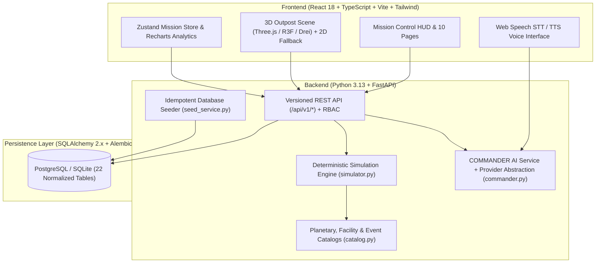

# ASTROMISSION — System Architecture

## Overview

**ASTROMISSION — Junior Astronaut Mission Trainer** is built as a modular monolith with strict separation between the **React + Three.js Frontend Presentation Layer**, the **FastAPI REST & Security Layer**, the **Deterministic Space Mission Simulation Engine**, the **COMMANDER AI Service**, and the **PostgreSQL / SQLAlchemy Persistence Layer**.

## Key Architectural Principles

1. **Authoritative Server-Side Simulation**: The frontend never sets resource values directly. Every construction, upgrade, repair, emergency choice, and `End Day` progression is validated and computed on the backend inside database transactions.
2. **Deterministic Reproducibility**: Each `MissionSession` stores a `random_seed`. Advancing a day uses `random.Random(random_seed + current_day * 1009)` so environmental hazards and dust storms can be deterministically tested and replayed.
3. **Graceful Hardware & Service Degradation**:
   - **3D WebGL Fallback**: Wrapped in `WebGLErrorBoundary` with an instant toggle to the interactive `OutpostBlueprint2D` view.
   - **AI Provider Fallback**: Supports external LLM APIs while defaulting seamlessly to the built-in NASA Scientific Telemetry Knowledge Engine so no external API key is required to play or learn.
   - **Voice Fallback**: Uses browser `SpeechRecognition` and `speechSynthesis` where supported, while preserving full text interaction everywhere.

